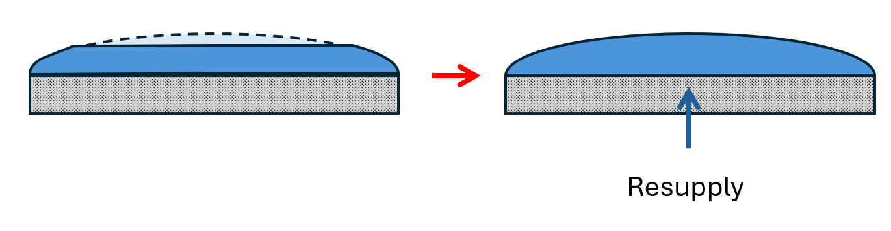
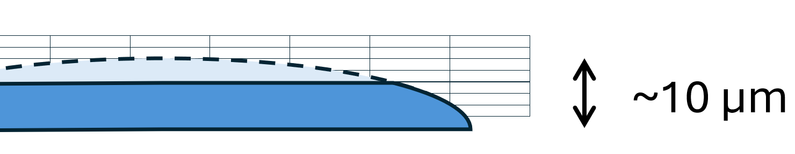

# Problem
The evolution of the film thickness and the free surface is central to predicting the dynamics of the tile. The basic physical chain is: the film is partially eroded by the incident heat flux; the balance of the surface tension, disjoining pressure, and internal/external pressure of the liquid returns it to its stable configuration; this restoration draws resupply flow from the reservoir. 

**Concern**:  
The mesh size required to capture the evolution of the surface shape and apply an accurate restoring force would be very fine.

## liquidFilm model

liquidFilmFoam is a finite area solver ($FOAM_APP/solvers/finiteArea/liquidFilmFoam). 

### Solver overview
1. Momentum equation:
$$\frac{\partial (hU)}{\partial t} + \nabla \cdot (hUU) + 0.0125f \lvert U\rvert U = G_Sh-S_dU-\frac{h}{\rho}\nabla(p)$$
2. Thickness equation (acts as the continuity equation):
$$ \frac{\partial h}{\partial t}+\nabla\cdot(\phi h)=S_m-S_d$$
3. Film pressure:
$$ p=\rho g h - \sigma \nabla^2(h)$$

### Notes & features
- Assumes a velocity profile (evidence?). It uses this and a hard-coded factor of 0.0125 to calculate a friction factor - almost certainly not suitable for this case.
- Bounds $h$ to a minimum value $h_0$. This means that it would not conserve mass if this were triggered; however, since the initial goal is not to model dryout dynamics this is not a significant disadvantage - the model could be set to terminate if the bounding is triggered (indicating dryout has been reached).
- Evolves the thickness field h and uses this to calculate capillary pressure
- Includes mass sources and sinks - should be able to link to evaporation & resupply terms?

# Issues
1 - Does it assume a parabolic velocity profile, and if so is this a no-go?

2 - There would be no way to solve the MHD-resolved flow in the film (non-obvious phenomena would not be captured). Is this problematic? 

I think I've been thinking about this the wrong way. I've been thinking that, any time there is mass loss from the surface due to evaporation, I need to resolve the change in contour of the free surface (the liquid metal - atmosphere interface) exactly, in order to resolve the force balance at the interface and find the restoring force that will tend to push the free surface back to its lowest-energy state, thereby replenishing the lost mass. But in reality this would take place on a timescale much shorter than the timescale of the simulation. Instead what I think I should be doing is just assuming that mass lost is replenished immediately:
- The shape of the interface is calculated from a force balance including surface tension/disjoining pressure, lorentz forces, marangoni forces, internal/external pressure. That sets the contour of the interface.
- When mass is lost from the surface through evaporation, instead of registering that as a change in the interface contour, I need to somehow **enforce that the lost mass must be replenished from the neighboring cells in the liquid** - the question is how.