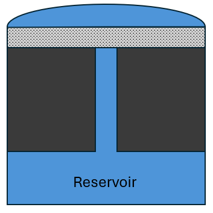
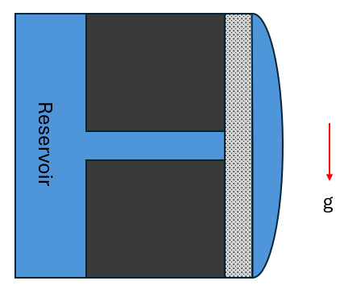

# Aim
To develop a model of the NSTX-U liquid-metal divertor module described in Rindt et al (2019). 

## 1. Thermal model
Solid domain and frozen liquid domain.  
Outputs: time-evolving surface temperature plot for applied heat flux
## 2. Hydrodynamic model
Hydrodynamic solve for fluid domain, with CPS treated as cell zone with momentum sink.  
**Problem**: with a fixed mass of liquid metal (not a flowing loop) the only source of fluid motion would be thermal-induced buoyancy effects, which would require defining a direction for gravity. However, the correct direction for gravity is:  

## 3. Free-surface model with phase change

## 4. MHD model